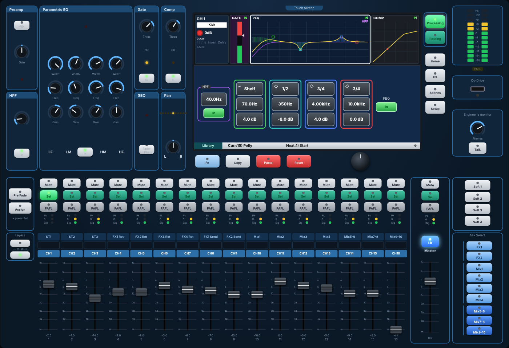

# QNU16

**An open-source 16-channel digital mixing console for a Raspberry Pi or a mini PC, controlled
from any tablet.**

QNU16 aims to compete with entry-level digital desks like the Allen & Heath Qu-16 for about a
quarter of the price. It pairs a cheap computer with a class-compliant USB interface and runs a
real-time mixing engine with a web control surface.



```
 mics ──► UMC1820 (8 pre) ──USB──► Raspberry Pi 5 / N100 ──USB──► UMC1820 outs ──► FOH, 4 monitors, PFL
          ADA8200 (8 pre) ─ADAT─┘   qnu16d + JACK
                                      │  HTTP / WebSocket
                                      ▼
                             tablet · phone · laptop (any browser, several at once)
```

## Features vs the Qu-16

| | QNU16 v0.3 | Qu-16 |
|---|---|---|
| Inputs | 16 mono + 3 stereo + 4 stereo FX returns | Same |
| Mixes | LR, Mix 1–4 (mono), Mix 5-6/7-8/9-10 (stereo), FX1/FX2 sends | Same |
| Input processing | Trim, polarity, FX insert, HPF (20 Hz–2 kHz), ducker, gate, 4-band PEQ (1.5–1/9 oct, LF/HF shelf at the widest width), compressor (Manual Peak/RMS, Auto Slow Opto/Punchbag, Hard Knee, ratio to ∞), delay (85 ms), stereo linking, AMM | Same |
| Master processing | FX insert, PEQ, 28-band GEQ with fader flip, compressor, delay (170 ms) | Same |
| FX | 4 engines: Reverb (Classic/Hall/Room/Plate), Delay, ADT, Chorus, Symphonic, Flanger, Phaser, Gated Verb; patched Insert, Mix>Return or Ch>Return | Same types (different algorithms) |
| RTA | 31 bands, follows PAFL, peak band in red; on Home, behind the GEQ and on the faders in fader flip | Same |
| DCAs / mute groups | 4 / 4 | 4 / 4 |
| Surface | The Qu-16 panel on a touch screen: SuperStrip, touch screen with Sel screens, Fn/Copy/Paste/Reset and rotary, layers, mix select, 4 SoftKeys, talk and phones | Physical surface + iPad app |
| Engineer's tools | Talkback (HPF, latch option), signal generator (sine, white, pink, band-pass), PAFL options, RTA and spectrogram | Same |
| Recording | Qu-Drive layout: 18-track (USB patch) or stereo 24-bit WAV, and playback | Same |
| Scenes | 100, with global and per-scene recall filters, safes, Reset Mix Settings; user libraries | Same |
| Outputs | 18 patchable (LR, mixes, PAFL, FX returns, direct outs) | 12 XLR + 2 Alt, plus USB |
| Motorised faders | Via an external MCU surface (roadmap) | 17 built-in |
| Latency | ≈ 5–7 ms round trip | ≈ 1–2 ms |
| Price | **≈ £540** with 16 preamps | ≈ £2,000+ |

The worst case (every processor on every channel and master, all sends, all four FX and the RTA)
uses about **13% of one x86 core** (including the AMM on all 16 channels). Run `qnu16-bench` on a Pi 5 to measure it there.

## Quick start (no audio hardware needed)

```bash
sudo apt install build-essential cmake pkg-config libjack-jackd2-dev   # JACK is optional for the demo
cmake -S . -B build && cmake --build build -j
./build/qnu16-tests                       # DSP, mixer, protocol and server tests
./build/qnu16d --backend dummy            # synthetic test signals on all 16 inputs
# open http://localhost:8016/
```

## On real hardware

```bash
sudo deploy/setup-pi.sh       # deps, build, RT limits, systemd services
sudo nano /etc/default/qnu16  # set JACK_DEVICE (see `aplay -l`)
sudo reboot                   # then browse to http://<pi>.local:8016/
```

See [docs/hardware.md](docs/hardware.md) for the parts list, output mapping, latency budget and tuning.

## Offline rendering ("virtual soundcheck")

```bash
./build/qnu16-render -s scenes/Gig.scene -o mix.wav drums.wav bass.wav vox.wav
```

The input files' channels feed the 22 physical inputs in order (1–16 are Ch 1–16, 17–22 are ST1–3).
The output is outputs 1–2 (LR with the default patch), or all 18 with `--all-outputs`.

## Using the surface

The page is the Qu-16 top panel, laid out as in the Qu Mixer Reference Guide, and works the same
way:

- **SuperStrip** (top left): Preamp (USB source key, Gain), HPF, Parametric EQ (Width, Freq,
  Gain per band, In), Gate and Comp (threshold, GR, In), GEQ Fader Flip and Pan, for the channel
  or master whose **Sel** key is lit. Pan follows the mix keys (LR pan, stereo mix send pan).
- **Touch screen**: **Processing** (TouchChannel blocks along the top; touch one for its
  parameters), **Routing** (Mix Sends, FX Sends, Mute/DCA; Fn opens the Mute/DCA masters),
  **Home** (Home, User, Meters, RTA with Fn Spectrogram, Qu-Drive), **FX** (front and back panel,
  Fn Library), **Scenes** (Scenes, Global Filter, Safes) and **Setup** (PAFL, Talkback, SigGen,
  AMM, Custom Layer, SoftKeys, Preferences, Output Patch, USB Audio).
- **Parameter boxes**: touch one (it turns orange), then turn the **screen rotary**, drag the
  box, or use the mouse wheel. **Fn** opens the page named at the left of the status bar.
- **Layers**: the lower key is CH1–16, the upper key ST1–3, FX returns, FX sends and mix masters;
  press the lit key again (or both) for the Custom layer.
- **Mix Select**: a mix key puts its sends on the faders; press it again for LR. Hold (or tap to
  latch) **Assign** or **Pre Fade** and press Sel keys; the master Sel toggles all sources.
- **Copy / Paste / Reset**: hold or latch, then press a Sel key (processing), an In key or block
  (one block), a Mix key (sends) or a scene.
- Double-click a fader or knob to reset it. Shift-drag for fine control.

## Repository layout

```
engine/src/dsp/       biquad, gate, compressor, delay, GEQ, RTA (header-only, allocation-free)
engine/src/topology.* console layout (inputs, buses, output patch sources)
engine/src/strip.*    processing chain shared by inputs and masters
engine/src/fx.*       FX engines (reverb, delay, ADT, chorus, symphonic, flanger, phaser, gated verb)
engine/src/recorder.* Qu-Drive recorder and player (lock-free rings + disk threads)
engine/src/mixer.*    signal flow: sends, groups, matrices, DCAs, mute groups, PAFL, meters
engine/src/params.*   lock-free parameter registry and labels
engine/src/scene.*    scenes (filters, safes, Reset Mix Settings) and user libraries
engine/src/controller.*  text control protocol (docs/protocol.md)
engine/src/server/    HTTP + WebSocket server (no dependencies)
engine/src/backend/   JACK backend and a dummy backend for development
engine/tools/         qnu16d (daemon), qnu16-render, qnu16-bench
ui/                   web control surface (core.js, surface.js, screens.js; no build step)
deploy/               Raspberry Pi / Debian setup and systemd units
tests/                unit and end-to-end tests
```

## Roadmap

1. **v0.4:** Mackie Control bridge for X-Touch motorised faders; MIDI control.
2. **v0.5:** Remote-controllable preamps (48V, pad, analogue gain) on a supported interface.
3. **v1.0:** A custom I/O board (TDM codecs straight into the Pi's I2S) to remove the USB interface
   and cut latency to about 1.5 ms.

## License

TBD.
